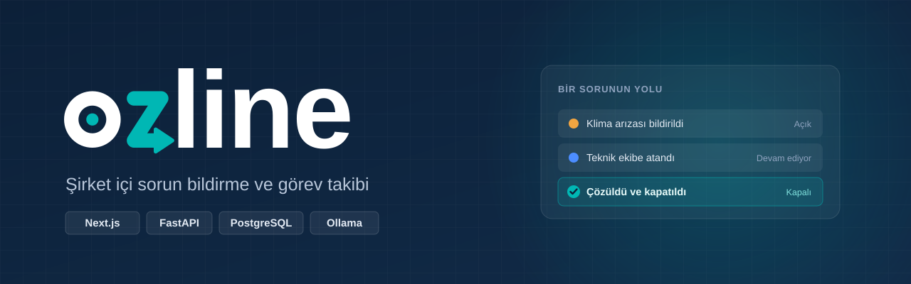
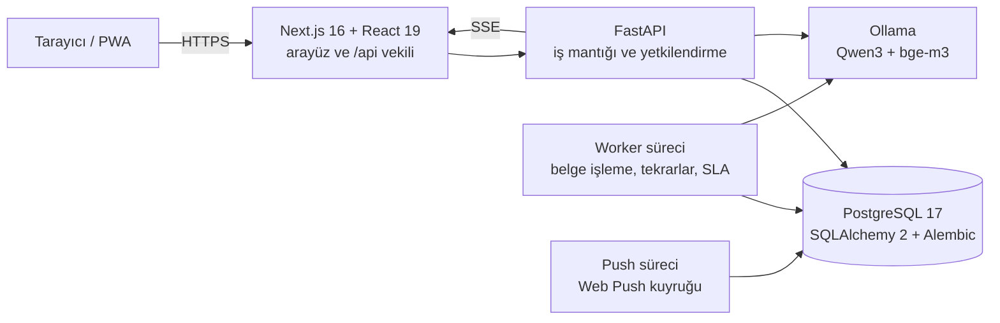

  

  <b>Şirket içi sorun bildirimi, görev takibi ve kaynaklı güvenlik formu yanıtlama platformu</b>

  
  
  
  
  
  

> Bu depo Ozline'ın **tanıtım** sayfasıdır. Kaynak kod gizli bir depoda tutulmaktadır; mülakat ve teknik değerlendirme için talep üzerine erişim verilebilir.

---

## Ozline nedir?

Ozline, bir şirketin çalışanlarının sorun ve şikâyet bildirdiği, yöneticilerin görev atadığı ve ekiplerin işi uçtan uca takip ettiği bir çalışma alanıdır. Buna ek olarak, şirket belgelerini kaynak göstererek müşteri güvenlik formlarını (Excel) yanıtlayan, her cevabı insan onayından geçiren bir modül içerir.

Uygulama tarayıcıda çalışır ve telefona/bilgisayara **PWA** olarak kurulabilir. Yapay zekâ asistanı, şirket verisini dışarı göndermeden **yerel modelle** (Ollama) çalışır.

## Öne çıkan özellikler

**Sorun ve görev yönetimi**
- Fotoğraflı/PDF ekli kayıt açma; atama, durum akışı (açık → devam ediyor → çözüldü → kapalı) ve yorumlar
- Liste ve Kanban görünümü, takvim (aylık/haftalık), Ctrl+K ile genel arama
- Alt görevler ve önkoşullar (döngü kontrolüyle), tekrarlayan görevler ve zorunlu kontrol listeleri
- SLA süre aşımı uyarıları, raporlar ve CSV dışa aktarma

**Şirket ve ekip**
- Davet koduyla çalışan katılımı, departmanlar ve departman lideri yetkisi
- Rol tabanlı görünürlük: yönetici her şeyi, lider kendi departmanını, çalışan yalnızca kendi kayıtlarını görür
- Duyurular (okundu takibi), sıralı onay talepleri (izin, satın alma)
- **Gizli bildirim kanalı:** taciz/etik ihlal gibi konular için anonim bildirim, erişim günlüğü ve sızıntı testleri

**Belge ve güvenlik formları**
- PDF, DOCX, TXT ve XLSX belge yükleme; sayfa/paragraf konumu korunarak parçalara ayırma
- **Hibrit arama:** BM25 kelime araması + `bge-m3` anlam vektörleri, RRF ile birleştirme
- Her cevap gerçek belge alıntısına bağlanır; insan onayı olmadan Excel çıktısı oluşmaz
- Onaylı cevap kütüphanesi ve benzer cevap önerisi

**Anlık güncelleme ve asistan**
- Server-Sent Events (SSE) ile yaklaşık 1 saniyede canlı güncelleme
- Uygulama içi ve Web Push bildirimleri
- Yerel Qwen3 modeliyle çalışan **Ozline Asistan**: "Bugün ne yapmalıyım?" gibi sorulara kaynaklı cevap verir, model kapalıyken uydurmaz

## Mimari

- **Tek yetki kaynağı:** Tüm yetkilendirme FastAPI'de; arayüz yalnızca sunum yapar. Görünürlük kuralı tek yerde tanımlı ve liste, rapor, CSV, arama ve asistan aynı fonksiyonu kullanır.
- **Kalıcı iş kuyruğu:** Veritabanı tabanlı, kiralamalı (lease) ve yeniden denemeli iş kuyruğu; iki worker aynı işi iki kez yapamaz.
- **Eşzamanlılık güvenliği:** Sürüm kontrollü güncellemeler (çakışmada 409), workspace düzeyinde atomik kilit.
- **Tip güvenli API sözleşmesi:** OpenAPI şemasından TypeScript tipleri üretilir; testler sözleşmenin eskimesini yakalar.
- **Docker Compose:** `db`, `migrate`, `api`, `worker`, `push`, `web` servisleri.

## Güvenlik

- Argon2 ile parola özeti; HttpOnly oturum çerezi, veritabanında yalnızca tokenın SHA-256 özeti
- Giriş denemelerinde hız sınırlama (429), hesap varlığını sızdırmayan sabit süreli doğrulama
- Yüklenen fotoğraflar yeniden kodlanır, EXIF/konum bilgisi silinir; SVG, HTML, ZIP ve etkin içerikli PDF reddedilir
- CSV çıktısında formül enjeksiyonuna karşı koruma
- Şirketler birbirinden tamamen ayrık; her sorgu üyelik kapsamıyla süzülür
- PWA önbelleği özel belge ve API yanıtlarını saklamaz

## Test ve kalite

| Alan | Kapsam |
|---|---|
| Backend | 32 pytest test dosyası (yetki, sızıntı, migration, eşzamanlılık, API sözleşmesi) |
| Uçtan uca | 15 Playwright senaryosu (şirket akışı, departmanlar, arama, asistan) |
| Arama kalitesi | Sentetik değerlendirme setinde hibrit arama ile Recall@3 **0,21 → 0,88** |
| Kod hacmi | ~11.400 satır Python, ~17.200 satır TypeScript |

## Teknolojiler

| Katman | Teknoloji |
|---|---|
| Arayüz | Next.js 16, React 19, TypeScript, PWA, Service Worker |
| Backend | Python, FastAPI, Pydantic, SQLAlchemy 2, Alembic |
| Veritabanı | PostgreSQL 17 (üretim), SQLite/WAL (yerel geliştirme) |
| Yapay zekâ | Ollama (Qwen3, bge-m3), OpenAI Structured Outputs (isteğe bağlı) |
| Test | pytest, Playwright |
| Altyapı | Docker Compose, Web Push (VAPID), SSE |

## İletişim

**Alimberk Özyürek**  
GitHub: [@ozyurekberk0-collab](https://github.com/ozyurekberk0-collab)

Kaynak koda erişim veya demo için GitHub üzerinden iletişime geçebilirsiniz.
