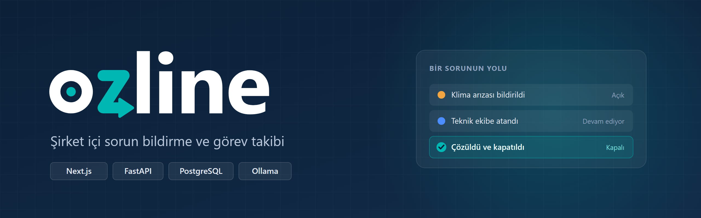
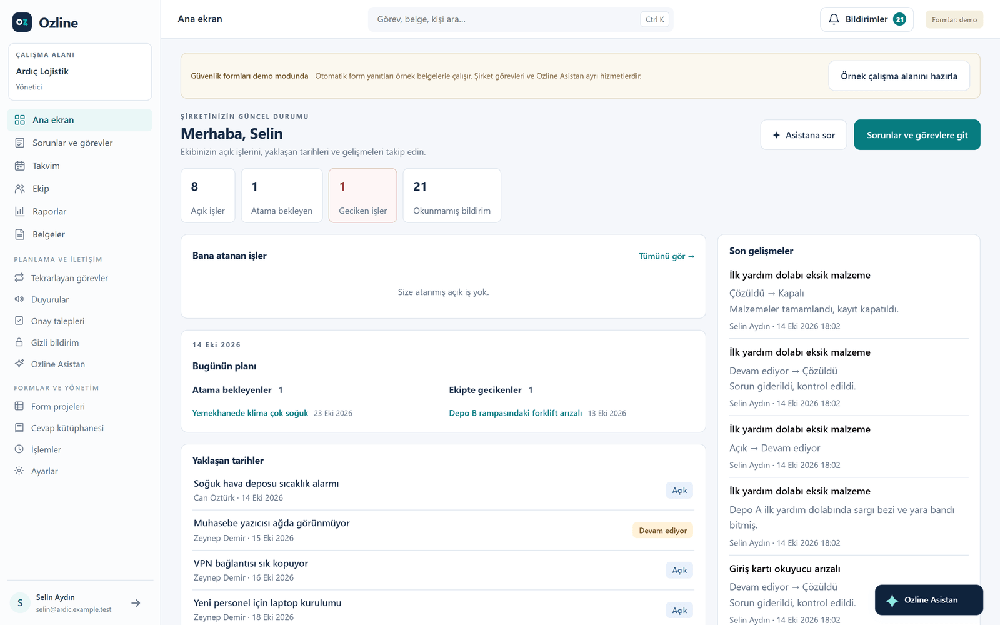
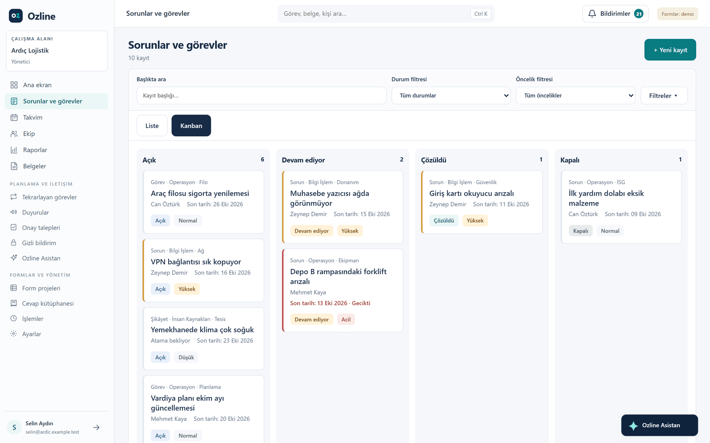
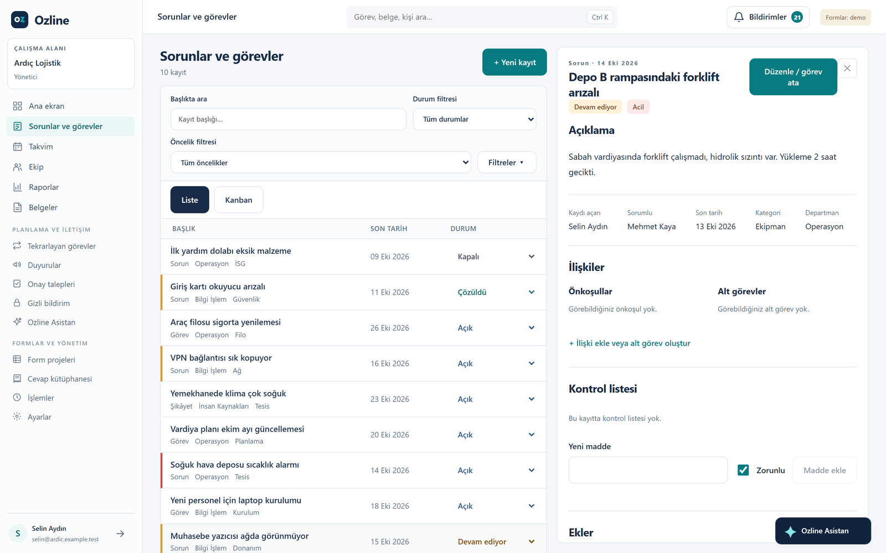
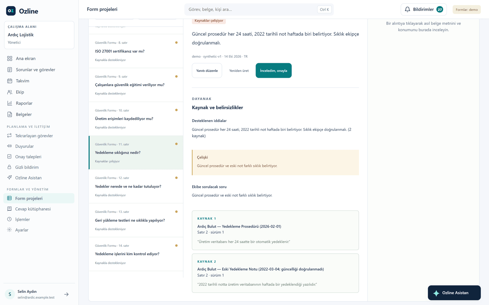
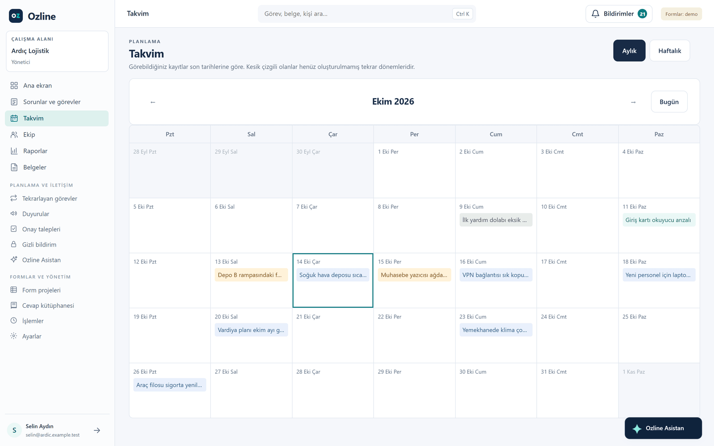
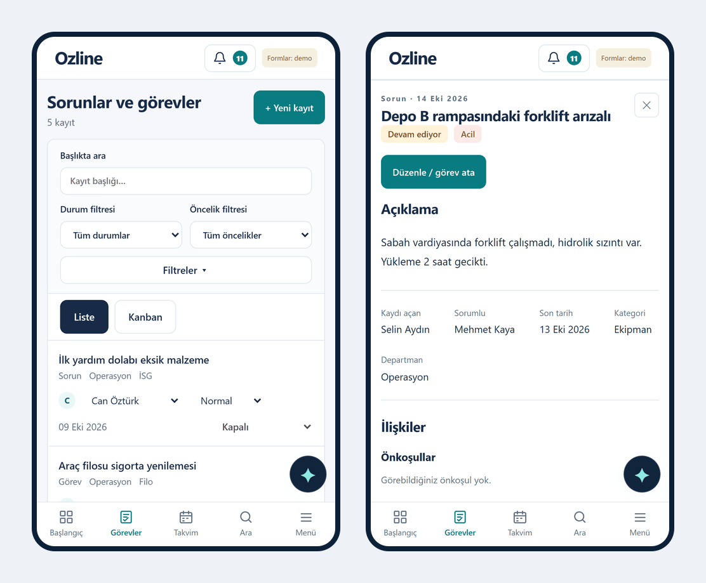

# Ozline

Ozline, şirket içinde sorunların ve görevlerin takip edildiği bir web uygulaması. Bir çalışan sorunu fotoğrafıyla bildiriyor, yönetici bunu birine atıyor, iş bitince kayıt kapanıyor. Bu süreçte ilgili herkese bildirim gidiyor.

Uygulamada ayrıca müşterilerden gelen güvenlik formlarını (Excel) şirketin kendi belgelerine bakarak dolduran bir modül var. Her cevabın hangi belgeden geldiği gösteriliyor. Bir kişi onaylamadan hiçbir cevap dosyaya yazılmıyor.

Kaynak kodu gizli bir repoda duruyor. İncelemek isterseniz bana ulaşın, erişim açabilirim.

## Ekran görüntüleri

Yöneticinin ana ekranı: açık işler, geciken işler, bugünün planı ve son gelişmeler.

Kayıtlar liste ya da kanban olarak görülebiliyor. Geciken işler kırmızıyla işaretleniyor.

Bir kayda tıklayınca detayı yan panelde açılıyor.

Güvenlik formunda bir soru. İki belge farklı şey söylüyor, uygulama bu çelişkiyi yakalayıp iki kaynağı da alıntısıyla gösteriyor.

Takvim ve telefon görünümü.

Ekran görüntülerindeki şirket ve kişiler örnek veridir.

## Neler var

- Sorun ve görev kaydı: atama, durum, öncelik, son tarih, yorum, fotoğraf ve PDF eki
- Liste, kanban ve takvim görünümü
- Departmanlar ve rollere göre yetki: yönetici her şeyi, departman lideri kendi departmanını, çalışan yalnızca kendi kayıtlarını görüyor
- Tekrarlayan görevler, kontrol listeleri, alt görevler ve önkoşullar
- Duyurular ve sıralı onay talepleri (izin, satın alma gibi)
- Taciz veya etik ihlal gibi konular için ayrı, anonim bir bildirim kanalı
- Süre aşımı uyarıları, raporlar ve CSV çıktısı
- Bilgisayarda yerel çalışan bir yapay zekâ asistanı (Ollama ve Qwen3). Şirket verisi dışarı gönderilmiyor.
- Telefona uygulama olarak kurulabiliyor (PWA)

## Kullandığım teknolojiler

| | |
|---|---|
| Arayüz | Next.js 16, React 19, TypeScript |
| Backend | Python, FastAPI, SQLAlchemy 2, Alembic |
| Veritabanı | PostgreSQL, yerelde SQLite |
| Yapay zekâ | Ollama, Qwen3, bge-m3 |
| Test | pytest, Playwright |
| Diğer | Docker Compose, Server-Sent Events, Web Push |

## Teknik notlar

- Yetki kontrolünün tamamı backend'de. Kimin neyi görebileceği tek bir yerde tanımlı; liste, rapor, CSV, arama ve asistan aynı kuralı kullanıyor.
- Belge aramasında kelime eşleşmesi (BM25) ile anlam benzerliğini (bge-m3) birlikte kullandım. Hazırladığım örnek test setinde doğru belgenin ilk üç sonuçta çıkma oranı %21'den %88'e çıktı.
- Belge işleme, tekrarlayan görevler ve süre aşımı kontrolü ayrı bir arka plan sürecinde çalışıyor.
- Ekranlar değişiklikleri SSE ile yaklaşık bir saniyede alıyor.
- Aynı kaydı iki kişi aynı anda düzenlerse eski sürümle kayıt yapılamıyor.
- Backend'de 32 test dosyası, arayüzde 15 Playwright senaryosu var.

## İletişim

Alimberk Özyürek
GitHub: [@ozyurekberk0-collab](https://github.com/ozyurekberk0-collab)
